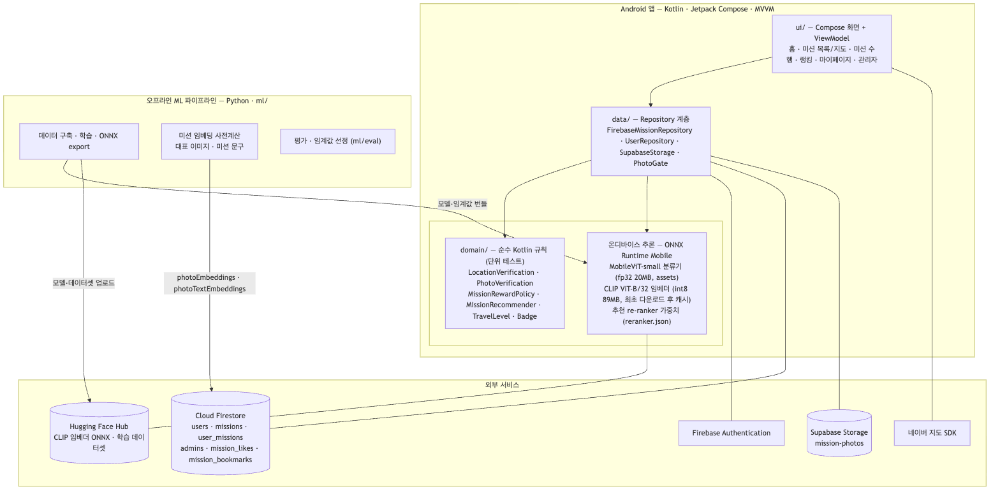
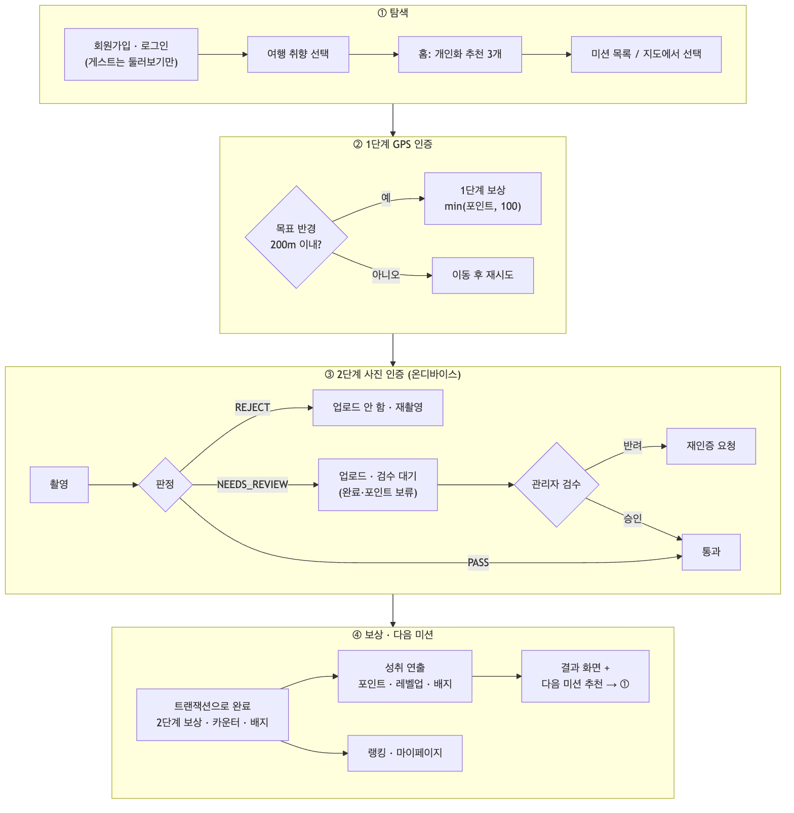
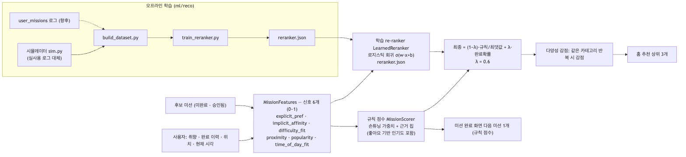
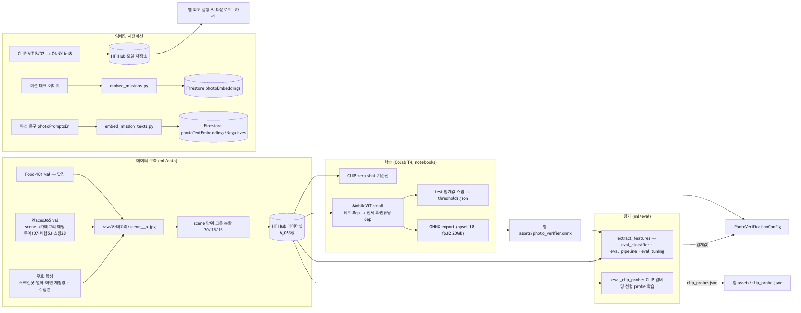

# 온디바이스 다중 신호 사진 인증과 하이브리드 추천을 적용한 여행 미션 게이미피케이션 앱

**On-Device Multi-Signal Photo Verification and Hybrid Recommendation for a Gamified Travel Mission App**

김가연 (2210723), 강규린 (2215987) · 숙명여자대학교 인공지능공학부 · 지도교수 김철연

> 본문의 모든 실험 수치는 저장소의 스크립트로 재현된다. 각 표 아래에 출처(스크립트·결과 파일)를 적었다.
> 사진 인증 재평가는 `ml/eval/`(README 참고), 추천은 `ml/reco/evaluate_reco.py` 이다.
> 개발 과정·문제 해결 기록은 `docs/dev-notes.md` 에 따로 남겼다.

---

## 초록

여행지에서 미션을 수행하고 인증하면 보상을 받는 게이미피케이션 앱은 인증의 신뢰도가 서비스의 공정성을 좌우한다. 본 연구는 서울 여행 미션 앱 *Seoul Quest* 를 개발하고, GPS 위치 인증 뒤에 이어지는 사진 인증을 **서버 없이 스마트폰에서** 자동 판정하는 방법을 제안한다. 사진 인증은 세 가지 신호를 결합한다. (1) 공개 데이터(Food-101, Places365)와 합성 무효 사진 6,063장으로 파인튜닝한 MobileViT-small 의 5클래스(투어·맛집·체험·쇼핑·무효) 분류, (2) 미션 대표 이미지와 촬영본의 CLIP 임베딩 유사도, (3) 미션의 영어 시각 묘사 문구와 촬영본의 CLIP 텍스트 일치도이다. 무효 사진은 다른 신호를 보기 전에 차단하고, 두 보조 신호는 분류 결과를 한 단계씩만 조정한다. 또한 대표 이미지 유사도를 위해 이미 계산하는 CLIP 임베딩 위에 선형 분류기를 얹어 분류 점수를 보정한다. test 셋 893장에서 분류 모델은 macro-F1 0.811(CLIP zero-shot 0.627)이었고, 선형 분류기 결합으로 0.828, 정상 사진 오거절률은 0.146에서 0.108로 낮아졌다(McNemar p = 0.006). 공개 데이터의 scene 을 가상 미션으로 본 실험에서, MobileViT 분류만 쓰면 같은 카테고리의 다른 대상 사진을 75.5% 통과시키고 정상 사진은 67.9%만 자동 통과했으나, 제안 방법은 각각 8.4%와 82.2%였다. 미션 추천은 6개 신호의 규칙 점수와 완료 로그로 학습한 로지스틱 회귀 re-ranker 를 섞어, 시뮬레이션 데이터에서 NDCG@5 를 0.918에서 0.947로 높였다.

**주제어**: 온디바이스 추론, 사진 인증, MobileViT, CLIP, 이미지-텍스트 일치도, 게이미피케이션, 하이브리드 추천

## Abstract

In gamified travel apps that reward users for completing on-site missions, the trustworthiness of mission verification determines fairness. We present *Seoul Quest*, a Seoul travel-mission Android app, and an on-device photo verification method that runs without a server after GPS verification. The verifier combines three signals: (1) a 5-class classifier (tour, food, experience, shopping, invalid) obtained by fine-tuning MobileViT-small on 6,063 images from Food-101, Places365, and synthesized invalid photos; (2) CLIP image-embedding similarity between the captured photo and the mission's reference images; and (3) CLIP image–text agreement between the photo and an English visual description of the mission. Invalid photos are rejected before any other signal is considered, and the two auxiliary signals adjust the classifier verdict by at most one step. We further reuse the CLIP embedding with a linear probe to refine category scores. On a 893-image test set, the classifier reaches macro-F1 0.811 (CLIP zero-shot: 0.627); adding the probe raises it to 0.828 and lowers the false-rejection rate of valid photos from 0.146 to 0.108 (McNemar p = 0.006). In a simulation that treats public-dataset scenes as virtual missions, MobileViT classification alone accepts 75.5% of same-category photos of a different target and auto-accepts only 67.9% of valid photos, whereas the proposed verifier yields 8.4% and 82.2%, respectively. For mission recommendation, a hybrid of a six-signal rule score and a logistic-regression re-ranker trained on completion logs improves NDCG@5 from 0.918 to 0.947 on simulated data.

**Keywords**: on-device inference, photo verification, MobileViT, CLIP, image–text agreement, gamification, hybrid recommendation

---

## 1. 서론

### 1.1 배경

서울을 찾는 관광객은 갈 곳을 직접 검색하고 동선을 짜야 한다. 여행 미션 앱은 "광장시장에서 육회 먹기", "반포대교 달빛무지개분수 보기" 같은 미션을 제시하고, 수행을 인증하면 포인트·레벨·배지·순위를 주어 탐색 자체를 놀이로 만든다. 게이미피케이션은 동기 부여에 효과가 있다고 보고되지만[10, 11], 보상이 걸린 순간 **인증의 신뢰도**가 서비스 공정성의 핵심이 된다. 인증 없이 사진만 올리면 통과하는 구조에서는 셀카·스크린샷·무관한 사진으로 보상을 받을 수 있다.

### 1.2 문제 정의

미션 인증은 두 단계로 구성한다. 1단계 GPS 인증은 사용자가 목표 지점 반경 200 m 안에 있는지를 본다. 2단계 사진 인증이 본 연구의 대상이며, 다음 세 질문에 답해야 한다.

| 질문 | 예 | 본 연구의 수단 |
| --- | --- | --- |
| (Q1) 인증에 쓸 수 없는 사진인가? | 셀카, 스크린샷, 화면 재촬영, 흐린 사진 | 분류기의 무효 클래스 |
| (Q2) 미션 *유형* 에 맞는 사진인가? | 맛집 미션에 음식 사진 | 분류기의 4개 카테고리 |
| (Q3) *이* 미션의 대상을 찍었는가? | 광장시장 육회 미션에 다른 식당 음식 | 대표 이미지 유사도 + 미션 문구 일치도 |

제약은 세 가지다. 첫째, 서버 추론 비용과 사진 전송을 피하기 위해 **온디바이스**로 판정한다. 둘째, 미션은 관리자와 사용자 제안으로 계속 늘어나므로 **미션을 추가할 때 재학습이 필요 없어야** 한다. 셋째, 오판의 비용이 비대칭이므로 애매한 사진은 거절 대신 **관리자 검수**로 보낸다.

### 1.3 기여

1. **다중 신호 온디바이스 사진 인증.** 카테고리 분류(Q1·Q2)에 CLIP 기반 대표 이미지 유사도와 미션 문구 일치도(Q3)를 결합하는 판정 규칙을 설계했다. 무효 판정을 가장 먼저 단락해 화면 재촬영 스푸핑을 막고, 보조 신호는 판정을 한 단계씩만 조정한다. 미션 추가 시 재학습 없이 대표 이미지와 문구 임베딩만 등록하면 된다.
2. **임베딩 재사용 선형 분류기.** 대표 이미지 유사도용으로 이미 계산하는 CLIP 임베딩 위에 21 KB 짜리 선형 분류기를 얹어, 추가 모델 없이 정상 사진 오거절을 유의하게 줄였다(6.5절).
3. **재현 가능한 평가.** 배포 모델과 같은 데이터 분할에서 분류 성능을 다시 재고, 공개 데이터의 scene 을 가상 미션으로 삼아 판정 파이프라인을 구성별로 비교(ablation)했다. 임계값은 validation 에서 고르고 test 에서 확인했다.
4. **하이브리드 추천.** 설명 가능한 규칙 점수와 완료 로그로 학습한 로지스틱 회귀 re-ranker 를 섞는 추천을 구현하고, 실제 로그로 교체 가능한 학습 파이프라인을 갖췄다.

---

## 2. 관련 연구

**경량 비전 모델과 온디바이스 추론.** MobileNet[9] 계열은 깊이별 분리 합성곱으로 모바일 연산량을 줄였고, Vision Transformer[8]는 전역 문맥을 잘 포착하지만 무겁다. MobileViT[1]는 합성곱과 트랜스포머 블록을 결합해 약 500만 파라미터에서 ImageNet 정확도와 지연을 함께 확보했다. 본 연구는 MobileViT-small 을 전이학습[6]해 ONNX Runtime[5]으로 기기에서 추론한다. 정수 양자화[20]는 모델 크기와 지연을 줄이는 대표적 방법으로, 본 연구의 CLIP 임베더에 적용했다.

**대조 학습 이미지-텍스트 모델.** CLIP[2]은 4억 쌍의 이미지-텍스트로 두 인코더를 같은 공간에 정렬해, 텍스트 프롬프트만으로 분류하는 zero-shot 과 고정 임베딩 위의 선형 분류(linear probe)에서 강한 성능을 보였다. 사전학습 표현 위의 선형 분류가 전이 성능의 좋은 척도라는 연구도 있다[21]. 한편 CLIP 임베딩은 이미지와 텍스트가 공간의 서로 다른 영역에 모이는 modality gap 이 있어[22], 코사인 유사도의 절대값이 좁은 구간에 몰린다. 본 연구는 이 점을 고려해 텍스트 일치도를 절대 코사인 대신 대조 문구에 대한 softmax 확률로 정의했다.

**장소·대상 인식.** 같은 장소인지 판정하는 문제는 랜드마크 검색(instance retrieval)으로 연구돼 왔다[23, 24]. 이들은 대규모 장소 데이터로 학습한 전용 임베딩을 쓰지만, 본 연구는 미션마다 재학습할 수 없으므로 범용 CLIP 임베딩과 소수의 대표 이미지로 검색 관점을 도입했다.

**게이미피케이션과 위치 기반 서비스.** 게이미피케이션은 비게임 맥락에 게임 요소를 쓰는 것으로 정의되며[10], 포인트·배지·순위가 참여를 높인다는 실증 연구가 많다[11]. 보상이 있는 위치 기반 서비스에서는 위치·인증 조작이 공정성을 해치므로, 본 연구는 GPS 인증 뒤에 사진 인증을 두는 2단계 구조를 택했다.

**추천.** 하이브리드 추천은 서로 다른 추천기의 장점을 결합한다[16, 15]. 본 연구는 콜드스타트에 강하고 설명 가능한 규칙 점수와, 로그에서 가중치를 배우는 로지스틱 회귀를 선형 결합한다. 순위 품질은 NDCG[17] 등으로 평가했다.

---

## 3. 시스템 설계

### 3.1 전체 구조



*그림 1. 전체 시스템 아키텍처 (원본: `docs/diagrams/01-system-architecture.mmd`)*

앱은 Kotlin·Jetpack Compose 로 만든 Android 앱이며 세 계층으로 나뉜다.

| 계층 | 역할 | 대표 구성요소 |
| --- | --- | --- |
| `ui/` | Compose 화면과 ViewModel. 위치·카메라 등 Android 연동 | `MissionPerformViewModel`, 관리자 화면 |
| `data/` | 데이터 접근 추상화와 외부 서비스 구현, 온디바이스 추론기 | `FirebaseMissionRepository`, `SupabaseStorage`, `OnnxPhotoVerifier`, `PhotoGate` |
| `domain/` | Firebase·Android 에 의존하지 않는 순수 Kotlin 규칙. 단위 테스트 대상 | `LocationVerification`, `PhotoVerification`, `MissionRewardPolicy`, `MissionRecommender` |

판정·보상·추천 규칙을 순수 Kotlin 으로 분리해, 실제 모델이나 서버 없이 단위 테스트로 검증한다(현재 130건). 외부 서비스는 Firebase Authentication(이메일 로그인), Cloud Firestore(문서 DB), Supabase Storage(사진 파일), Hugging Face Hub(CLIP 임베더·데이터셋 호스팅), 네이버 지도 SDK 이다. 클라이언트가 Firestore 를 직접 쓰므로 보안 규칙으로 소유권·문서 형태를 강제하고, 에뮬레이터 테스트 38건으로 검증했다.

### 3.2 서비스 흐름



*그림 2. 미션 탐색에서 보상·다음 추천까지의 흐름과 사용자 미션 제안·검수 흐름*

1. 회원가입 후 여행 취향(투어·맛집·체험·쇼핑)을 고르면 홈에 추천 미션 3개가 보인다(4.7절).
2. 미션 목록이나 네이버 지도에서 미션을 고르고 시작한다.
3. **1단계 GPS 인증**: 현재 위치와 미션 좌표의 거리(Haversine)가 200 m 이내면 통과하고 1단계 보상 `min(미션 포인트, 100)` 을 준다.
4. **2단계 사진 인증**: 촬영본을 업로드 **전에** 기기에서 판정한다(4장). `REJECT` 는 업로드하지 않고 재촬영을 안내하고, `NEEDS_REVIEW` 는 업로드 후 관리자 검수를 기다리며(완료·포인트 보류), `PASS` 는 트랜잭션으로 미션을 완료하고 나머지 보상을 준다.
5. 완료 시 레벨(누적 포인트 기반 Lv.1~5)과 배지 3종(첫 발자국·주간 탐험가·취향 발견)을 같은 트랜잭션에서 계산하고, 결과 화면에서 다음 미션을 추천한다.
6. 사용자는 새 미션을 제안할 수 있다. 제안은 `pending`(포인트 0)으로 저장되고, 관리자가 승인(포인트 확정)·수정 요청·반려한다. 승인 전에는 목록·지도·추천에 나타나지 않는다.

### 3.3 데이터 모델

| 컬렉션 | 주요 필드 |
| --- | --- |
| `users/{uid}` | 닉네임, 포인트, 취향, 완료 카운터(전체·카테고리별·주별), 배지 |
| `missions/{id}` | 제목·설명(한·영·일), 카테고리, 포인트, 좌표, 대표 이미지, `photoEmbeddings`(대표 이미지 CLIP 임베딩 배열), `photoPromptsEn`·`photoTextEmbeddings`·`photoTextNegatives`(미션 문구와 대조 문구의 CLIP 텍스트 임베딩), 검수 상태 |
| `user_missions/{id}` | 진행 상태, 단계별 보상 지급 여부, 사진 URL, 판정 근거(`photoVerifyScore`, `photoVerifySimilarity`, `photoVerifyTextMatch`, 모델 버전), 검수 플래그 |

Firestore 는 배열의 배열을 저장할 수 없어, 임베딩 배열의 원소를 `{"v": [...]}` 맵으로 감쌌다.

---

## 4. AI 방법론

### 4.1 개요


*그림 3. 온디바이스 사진 인증 파이프라인과 판정 규칙*

촬영본 한 장에 대해 두 모델을 기기에서 돌린다. MobileViT-small 분류기는 5클래스 확률을, CLIP ViT-B/32 이미지 인코더는 512차원 임베딩 **e** 를 낸다. **e** 는 세 곳에 쓰인다: (a) 카테고리 점수를 보정하는 선형 분류기(4.3절), (b) 미션 대표 이미지와의 유사도(4.4절), (c) 미션 문구와의 일치도(4.5절). 미션별 대표 이미지·문구 임베딩은 관리자 스크립트로 미리 계산해 Firestore 에 두므로, 인증 시점에는 내적만 계산한다.

### 4.2 데이터셋

실제 미션 사진이 없으므로 공개 데이터와 합성 데이터로 5클래스 데이터셋을 만들었다(`ml/data/`, HF Hub 비공개 `kimgayeon430/travel-mission-photos`).

| 클래스 | 출처 | scene 수 |
| --- | --- | ---: |
| 맛집 | Food-101[3] validation, 101개 음식 클래스에서 고르게 표본 | 101 |
| 투어·체험·쇼핑 | Places365[4] validation, scene 을 카테고리에 수동 매핑 | 107 · 53 · 28 |
| 무효 | 합성: 가짜 UI 스크린샷, 다른 클래스 사진 열화(블러·저조도·과다확대), 화면 재촬영(베젤·무아레·글레어), 직접 수집한 셀카·스크린샷 | — |

| split | 투어 | 맛집 | 체험 | 쇼핑 | 무효 | 합계 |
| --- | ---: | ---: | ---: | ---: | ---: | ---: |
| train | 698 | 700 | 700 | 705 | 1,444 | 4,247 |
| validation | 152 | 150 | 150 | 161 | 310 | 923 |
| test | 150 | 150 | 150 | 134 | 309 | 893 |
| 합계 | 1,000 | 1,000 | 1,000 | 1,000 | 2,063 | 6,063 |

분할은 파일명의 sceneId 단위로 묶어(70/15/15), 같은 scene 이 train 과 test 에 함께 들어가 성능이 부풀려지는 것을 막았다(공개 데이터 4클래스는 train–test scene 겹침 0). 화면 재촬영 합성은 실기기에서 모니터에 띄운 대표 이미지를 다시 찍어도 무효로 걸리지 않는 문제(무효 점수 0.066)를 발견한 뒤 추가했다.

### 4.3 카테고리 분류

**MobileViT-small 전이학습.** `apple/mobilevit-small` 에 5클래스 분류 헤드를 얹어 두 단계로 학습했다: 백본을 고정하고 헤드만 8 epoch(lr 1e-3) 학습한 뒤, 전체를 6 epoch(lr 5e-5) 파인튜닝했다. 증강은 좌우 반전과 색 변화, 클래스 불균형은 가중치로 보정했다(Colab T4, 약 30분). 전처리는 짧은 변 288 리사이즈 → 256 중앙 자르기 → [0,1] 스케일 → RGB→BGR 이다. 모델은 ONNX(opset 18, fp32, 약 20 MB, 493만 파라미터)로 변환해 앱에 번들하고, 전처리 상수는 export 산출물 JSON 에서 읽어 학습·추론 전처리를 일치시킨다.

**CLIP 선형 분류기 결합.** CLIP 임베딩 **e** 위에 5클래스 로지스틱 회귀 `p_probe = softmax(W·e + b)` (W ∈ ℝ^{5×512}) 를 train 셋으로 학습하고(규제 C=3), MobileViT 확률 `p_mvit` 와 섞는다.

```
s[c]  = (1 − w) · p_mvit[c] + w · p_probe[c]     (c ∈ {투어, 맛집, 체험, 쇼핑}),  w = 0.9
s[무효] = p_mvit[무효]
```

C 와 w 는 validation macro-F1 로 골랐다. 무효 점수를 섞지 않는 이유는, 무효 게이트가 화면 재촬영 같은 스푸핑을 막는 첫 관문이고 그 합성 데이터로 직접 학습한 MobileViT 의 판단이 더 믿을 만하기 때문이다(6.5절에서 무효 recall 유지를 확인). 임베더를 아직 받지 못한 경우에는 MobileViT 점수만 쓴다.

### 4.4 대표 이미지 유사도

미션 대표 이미지(1장 이상)의 CLIP 임베딩 {**r**_j} 와 촬영본 임베딩의 최대 코사인 유사도를 쓴다.

```
sim = max_j cos(e, r_j)
```

처음에는 분류기의 pooled feature 를 임베딩으로 재사용하려 했으나, 같은 카테고리의 다른 대상을 구분하는 ROC AUC 가 0.60에 그쳐(분류 학습으로 특징이 클래스 방향으로 붕괴) 범용 CLIP 인코더(AUC 0.76)를 채택했다. CLIP 인코더는 int8 동적 양자화로 약 89 MB 이며, APK 에 넣지 않고 미션 수행 화면에 들어갈 때 Hugging Face Hub 에서 한 번 내려받아 캐시한다.

### 4.5 미션 문구 일치도

CLIP 은 이미지와 텍스트를 같은 공간에 두므로, 미션이 요구하는 대상을 글로 적어 두면 대표 이미지가 없거나 구도가 다른 경우에도 비교할 수 있다. 각 미션에 사진에 찍혀야 할 대상을 묘사한 영어 문구 `photoPromptsEn` 1~2개를 두고(예: 명동교자 → "a bowl of kalguksu noodle soup with dumplings"), 대조 문구로 다른 미션의 문구 전부와 무효 문구 8개(셀카·스크린샷 등)를 둔다(현재 미션당 약 110개). 일치도는 이 미션 문구 중 가장 가까운 것의 softmax 확률이다.

```
text = exp(τ·max_k cos(e, t_k)) / ( exp(τ·max_k cos(e, t_k)) + Σ_n exp(τ·cos(e, u_n)) ),   τ = 100
```

**t**_k 는 미션 문구, **u**_n 은 대조 문구 임베딩이다. CLIP 의 코사인은 좁은 구간(보통 0.2~0.35)에 몰려 미션마다 기준이 다르지만[22], 대조 문구에 대한 확률은 0~1 로 비교하기 쉽다. 우연 수준은 1/(N+1) ≈ 0.009 이다. 미션 제목을 그대로 쓴 문구("a photo of 〈제목〉")보다 시각 묘사 문구가 자기 미션 확률 중앙값을 0.52에서 0.75로 높였다(6.3절).

### 4.6 판정 규칙

판정은 `PASS`(자동 통과) / `NEEDS_REVIEW`(관리자 검수) / `REJECT`(재촬영) 세 가지이며, 순수 Kotlin 함수 `PhotoVerification.verify` 로 구현했다.

```
입력: 미션 카테고리 c, 점수 s(4.3), 유사도 sim(없으면 ⊥), 일치도 text(없으면 ⊥)
1  if s[무효] ≥ 0.55:            return REJECT            # 무효는 다른 신호보다 먼저 단락
2  base ← REJECT  if s[c] < 0.22
          PASS    if s[c] ≥ 0.65
          REVIEW  otherwise
3  if sim = ⊥ and text = ⊥:     return base
4  rescue  ← sim ≥ 0.50 or text ≥ 0.30                   # 이 미션의 대상과 어느 정도 닮음
   support ← sim ≥ 0.76 or text ≥ 0.30                   # 이 미션의 대상과 확실히 닮음
   against ← sim < 0.76 and text < 0.02                  # 어느 신호도 닮았다고 보지 않음
5  if base = REJECT and rescue:  return REVIEW           # 약한 카테고리 구제
   if base = REVIEW and support: return PASS             # 애매한 분류를 대상 일치가 뒷받침
   if base = PASS   and against: return REVIEW           # 같은 유형의 다른 대상 의심
   return base
```

설계 원칙은 두 가지다. **(가) 무효는 먼저 단락한다.** 대표 이미지를 화면에 띄워 다시 찍으면 유사도가 오히려 높게 나오므로(실기기 0.673), 스푸핑은 유사도가 아니라 무효 클래스로 막아야 한다. **(나) 카테고리 점수로는 단락하지 않는다.** 공개 데이터로 학습한 분류기는 실제 미션 사진에서 카테고리 점수를 낮게 내는 경우가 많아(실기기 숙대입구 정상 사진 s[c] = 0.108), 보조 신호가 이를 구제할 기회를 남겨야 한다. 보조 신호는 판정을 한 단계씩만 바꾸며, 둘 중 하나라도 근거가 되면 인정한다.

임계값은 `PhotoVerificationConfig` 에 모았다. 분류 임계값(0.65 / 0.22 / 0.55)은 학습 노트북의 test 임계값 스윕, 유사도 구제 기준 0.50 은 공개 프록시의 같은 대상 쌍 하위 15%, 문구 기준(0.30 / 0.02)은 실제 미션의 자기·다른 미션 확률 분포, 유사도 의심 기준 0.76 은 validation 가상 미션에서 골랐다(6.5절 E4).

### 4.7 하이브리드 미션 추천



*그림 4. 규칙 점수와 학습 re-ranker 를 결합한 추천*

후보 미션(미완료·승인됨)마다 0~1 로 정규화한 신호 6개를 계산한다: 명시 취향(`explicit_pref`), 카테고리 완료 비율(`implicit_affinity`), 난이도 적합도(`difficulty_fit`), 거리 근접도(`proximity`), 인기도(`popularity`), 시간대 적합도(`time_of_day_fit`). 규칙 점수는 손으로 정한 가중합이고 근거 칩("맛집 취향", "가까운 미션")을 함께 만든다. 학습 re-ranker 는 같은 신호로 완료 여부를 예측하는 로지스틱 회귀 `σ(w·x + b)` 이다. 최종 점수는

```
score = (1 − λ) · rule / max(rule) + λ · P(완료),   λ = 0.6
```

이며, 같은 카테고리를 반복해 뽑을 때마다 감점해 상위 3개를 고른다. 학습 가중치 파일이 없으면 규칙 점수만 쓴다(콜드스타트). 실제 완료 로그가 충분하지 않아, 규칙 가정과 **다른** 참 선호(인기도·거리는 거의 무의미, 난이도·시간대는 중요)를 가진 시뮬레이터로 학습 데이터를 만들어, 학습이 규칙의 손튜닝 오류를 교정하는지 검증했다.

---

## 5. 구현

### 5.1 오프라인 파이프라인



*그림 5. 데이터 구축 → 학습 → export → 미션 임베딩 사전계산 → 평가*

| 단계 | 스크립트 | 산출물 |
| --- | --- | --- |
| 데이터 구축 | `ml/data/fetch_public.py`, `make_negatives.py`, `build_dataset.py`, `upload_hf.py` | HF 데이터셋 6,063장 |
| 분류기 학습 | `ml/notebooks/train_photo_verifier.ipynb` | `assets/photo_verifier.onnx`, `thresholds.json` |
| CLIP 임베더 | `ml/export_clip_image_encoder.py` | HF Hub `photo_embedder_int8.onnx` |
| 미션 임베딩 | `ml/embed_missions.py`, `ml/embed_mission_texts.py` | Firestore `photoEmbeddings`, `photoTextEmbeddings`, `photoTextNegatives` |
| 선형 분류기 | `ml/eval/eval_clip_probe.py --export` | `assets/clip_probe.json` (21 KB) |
| 추천 | `ml/reco/build_dataset.py`, `train_reranker.py` | `assets/reranker.json` |
| 평가 | `ml/eval/*.py`, `ml/reco/evaluate_reco.py` | `ml/eval/results/*.json` |

### 5.2 앱 통합

- **추론**: `OnnxPhotoVerifier` 가 ONNX Runtime Mobile 로 분류기를 돌리고, `OnnxClipPhotoEmbedder` 의 임베딩이 있으면 `CategoryProbe` 로 점수를 보정한다. EXIF 회전을 반영해 디코드한다. 모델 로딩이 실패하면 통과가 아니라 전부 검수로 보낸다(`passWhenModelUnavailable = false`).
- **업로드 전 판정**: `PhotoGate` 가 추론과 판정을 묶어 `Reject` / `Proceed(needsReview)` 를 돌려주고, 저장소는 그 결과에 따라 업로드만 한다. 거절된 사진은 업로드하지 않아 저장 비용도 아낀다.
- **기록과 검수**: 판정 근거(점수·유사도·일치도·모델 버전)를 `user_missions` 에 남기고, 관리자 검수 화면에 표시한다. 승인 시 완료·보상을, 반려 시 재인증을 요구한다.
- **비용**: 분류기 fp32 약 20 MB(APK 번들), CLIP 임베더 int8 88.6 MB(최초 1회 다운로드), 선형 분류기 21 KB. ONNX Runtime 네이티브 라이브러리는 `arm64-v8a`/`x86_64` 만 넣어 APK 증가를 약 20 MB 로 줄였다. 실기기(Galaxy S8) 분류 추론은 약 0.9초였다.
- **기타 기능**: 레벨·배지·성취 연출, 랭킹, 포인트 내역, 미션 제안·검수, 좋아요·찜, 한국어·영어·일본어 UI 전환을 구현했다. 상세는 `docs/dev-notes.md` 에 있다.

---

## 6. 실험 및 평가

### 6.1 실험 설정

- **데이터**: 4.2절 데이터셋(HF 리비전 `d4c8a38`, 배포 모델을 학습한 분할). 분류 평가는 test 893장.
- **모델**: 앱에 번들된 ONNX 분류기와 같은 파일을 ONNX Runtime 으로 직접 실행했다. CLIP 은 fp32 로 계산하고, 앱의 int8 임베더로도 별도 확인했다.
- **지표**: accuracy, macro-F1(95% 부트스트랩 신뢰구간 1,000회[14]), ECE[12]. 판정 수준에서는 **정상 PASS 율**, **정상 오거절률**(정상 사진이 `REJECT`), **오수락률**(정상이 아닌 사진이 `PASS`), **검수 비율**. 두 분류기의 차이는 McNemar 정확 검정[13]으로 본다.
- **원칙**: 임계값·결합 가중치 등은 validation 에서만 고르고 test 는 한 번만 본다. validation 과 test 는 scene 이 겹치지 않는다.
- **재현**: `ml/eval/README.md` 의 명령으로 모든 표를 다시 만들 수 있다.

### 6.2 카테고리 분류 성능

*출처: `ml/eval/eval_classifier.py`, `eval_clip_probe.py` → `results/classifier.json`, `clip_probe.json`*

| 모델 | accuracy | macro-F1 [95% CI] | ECE | 무효 recall | 정상 오거절 |
| --- | ---: | ---: | ---: | ---: | ---: |
| CLIP ViT-B/32 zero-shot | 0.648 | 0.627 [0.595, 0.660] | 0.102 | 0.667 | 0.327 |
| MobileViT-small 파인튜닝 | 0.842 | 0.811 [0.784, 0.838] | 0.032 | 0.932 | 0.146 |
| **MobileViT + CLIP 선형 분류기 (제안)** | **0.852** | **0.828** [0.801, 0.853] | 0.038 | **0.932** | **0.108** |

*무효 recall 은 s[무효] ≥ 0.55 비율, 정상 오거절은 정상 사진 584장을 자기 카테고리 미션에 냈을 때 `REJECT` 비율(보조 신호 없음).*

| 클래스 F1 | 투어 | 맛집 | 체험 | 쇼핑 | 무효 |
| --- | ---: | ---: | ---: | ---: | ---: |
| CLIP zero-shot | 0.626 | 0.746 | 0.431 | 0.636 | 0.696 |
| MobileViT | 0.788 | 0.939 | 0.637 | 0.725 | 0.965 |
| 제안 | 0.760 | 0.949 | 0.676 | 0.793 | 0.962 |

파인튜닝은 zero-shot 대비 macro-F1 을 0.18 높였다. 가장 약한 클래스는 체험(recall 0.573)으로, 혼동행렬에서 체험 150장 중 28장이 투어, 33장이 쇼핑으로 분류됐다. Places365 의 체험 scene(공방·교실 등)이 실내 상점·관광지와 시각적으로 겹치기 때문이다. 선형 분류기 결합은 체험(0.637 → 0.676)과 쇼핑(0.725 → 0.793)을 끌어올렸다. 전체 정확도 차이는 통계적으로 유의하지 않았으나(McNemar p = 0.49), **정상 사진 오거절 감소는 유의했다**(MobileViT 만 거절 41장 vs 제안만 거절 19장, p = 0.006). 앱이 실제로 쓰는 int8 임베더로 계산해도 macro-F1 0.830, 오거절 0.115 로 같은 수준이었다(fp32 와 임베딩 코사인 평균 0.970; `eval_int8_embedder.py`).

화면 재촬영 합성을 넣어 재학습하기 전의 배포 모델은 같은 test 에서 무효 recall 0.738 이었고, 재학습 후 0.932 가 되었다(`eval_model_versions.py`; 이전 모델은 다른 데이터 리비전으로 학습돼 참고치).

### 6.3 미션 대상 일치 신호의 분리도

*출처: `eval_pipeline.py`(가상 미션), `eval_real_missions.py`(실제 미션, Firestore 읽기 전용)*

**가상 미션.** test 의 scene(예: bakery, steak) 하나를 미션 하나로 보고, 대표 이미지 = 그 scene 의 첫 사진, 미션 문구 = "a photo of a 〈scene 이름〉" 으로 두었다(51개 미션). 같은 scene 의 나머지 사진(정상, 533건)과 같은 카테고리의 다른 scene 사진(다른 대상, 510건)을 얼마나 구분하는지 ROC AUC 로 쟀다.

| 카테고리 | 대표 이미지 유사도 AUC | 문구 일치도 AUC |
| --- | ---: | ---: |
| 맛집 | 0.938 | 0.998 |
| 체험 | 0.903 | 0.992 |
| 투어 | 0.816 | 0.977 |
| 쇼핑 | 0.824 | 0.938 |
| 전체 | 0.731 | 0.984 |

**실제 미션.** 대표 이미지가 있는 17개 미션(전체 52개)에서 쟀다.

| 신호 | 같은 미션 | 다른 미션 | AUC |
| --- | --- | --- | ---: |
| 대표 이미지끼리 코사인 | 중앙값 0.606 (94쌍) | 중앙값 0.433 · 상위 10% 0.556 | 0.829 |
| 문구 일치도 (첫 대표 이미지 기준) | 중앙값 0.750 · 하위 10% 0.046 (17건) | 상위 5% 0.009 · 상위 1% 0.137 (867건) | 0.992 |

| 미션 문구 | 자기 미션 중앙값 | 자기 문구가 1등인 비율 | 다른 미션 상위 1% |
| --- | ---: | ---: | ---: |
| 제목 그대로 ("a photo of 〈제목〉") | 0.52 | 53% | 0.19 |
| 시각 묘사 (`photoPromptsEn`) | 0.75 | 65% | 0.137 |

문구 일치도는 두 설정 모두에서 대표 이미지 유사도보다 분리력이 높았다. 다만 가상 미션의 문구는 CLIP 이 잘 아는 scene 이름이라 실제보다 쉬우며, 실제 미션의 표본은 17건으로 작다.

### 6.4 판정 파이프라인 구성 비교 (ablation)

*출처: `eval_pipeline.py` → `results/pipeline_test_k1_*.json`*

6.3절의 가상 미션 51개에 정상 533건, 같은 카테고리 다른 대상 510건, 무효 309건을 제출하고, 4.6절 판정 규칙(앱과 같은 로직의 파이썬 미러)으로 판정했다. 아래는 최종 설정(선형 분류기 결합, 유사도 의심 기준 0.76)이다.

| 구성 | 정상 PASS ↑ | 정상 오거절 ↓ | 다른 대상 오수락 ↓ | 무효 오수락 ↓ | 검수 비율 |
| --- | ---: | ---: | ---: | ---: | ---: |
| A. 분류만 | 0.711 | 0.107 | 0.755 | 0.006 | 0.128 |
| B. + 대표 이미지 유사도 | 0.246 | 0.023 | 0.016 | 0.000 | 0.631 |
| C. + 문구 일치도 | 0.822 | 0.036 | 0.076 | 0.000 | 0.370 |
| **D. 전부 (앱)** | **0.822** | **0.013** | **0.084** | **0.000** | 0.382 |

- **분류만으로는 Q3 를 풀 수 없다.** 같은 카테고리의 다른 대상을 75.5% 통과시킨다.
- **대표 이미지 유사도만 더하면** 오수락은 1.6%로 줄지만, 대표 이미지가 한 장뿐이라 정상 사진도 대부분 닮았다고 보지 못해 검수로 보낸다(검수 63%).
- **문구 일치도를 더하면** 정상 PASS 를 높이면서(0.711 → 0.822) 오수락을 7.6%로 낮춘다. 두 신호를 함께 쓰면(D) 정상 오거절이 가장 낮다(1.3%).
- 무효 사진은 어느 구성에서도 거의 통과하지 못했다. 무효 게이트를 보조 신호보다 먼저 두는 설계 덕분이다.

**대표 이미지 수.** 미션당 대표 이미지를 3장으로 늘리면(k=3) D 의 정상 오거절이 0.7%로 줄고 오수락은 6.8%였다. 다만 최대 유사도는 다른 대상에서도 함께 오르므로, 의심 기준을 0.68 로 두면 오수락이 25.4%까지 늘었다. 대표 이미지를 늘릴 때는 임계값을 함께 맞춰야 한다.

### 6.5 성능 개선 실험

모든 선택은 validation 에서 하고 test 결과를 보고한다. 기준은 개선 전 앱(MobileViT 점수, 유사도 의심 기준 0.68)이다.

| 실험 | 내용 | test 결과 | 채택 |
| --- | --- | --- | :---: |
| E1 | 좌우 반전 TTA | macro-F1 0.811 → 0.813, 오거절 변화 없음 | ✗ |
| E2 | CLIP zero-shot 확률과 결합 (w = 0.25) | macro-F1 0.815, 오거절 0.125, 검수 0.171 → 0.255 | ✗ |
| E3 | CLIP 임베딩 선형 분류기 결합, 무효 점수 유지 (C = 3, w = 0.9) | macro-F1 0.811 → 0.828, 오거절 0.146 → 0.108 (p = 0.006) | ✓ |
| E4 | 유사도 의심 기준 재선택 (0.68 → 0.76) | 다른 대상 오수락 0.184 → 0.084, 정상 PASS 0.803 → 0.794 | ✓ |
| E5 | 미션 문구 3종 앙상블 | 오수락 0.184 → 0.176, 정상 PASS 0.803 → 0.788 | ✗ |

E1 은 추론을 두 배로 늘리지만 효과가 없었고, E2 는 검수 비율을 크게 늘렸다. E3 의 선형 분류기 단독은 무효 recall 이 0.919 로 떨어졌으나, 무효 점수를 MobileViT 로 유지하자 0.932 로 회복됐다(E3b 0.919 → E3c 0.932). E4 는 validation 에서 결합 규칙·임계값 조합 300개를 탐색해, 다른 대상 오수락 10% 이하·무효 오수락 1% 이하를 만족하면서 정상 PASS 가 가장 높은 조합에서 유사도 기준만 가져왔다(문구 기준은 실제 미션 분포 근거를 유지).

**개선 전후 (구성 D)**

| | 정상 PASS | 정상 오거절 | 다른 대상 오수락 | 무효 오수락 | 검수 비율 |
| --- | ---: | ---: | ---: | ---: | ---: |
| 개선 전 | 0.803 | 0.017 | 0.184 | 0.003 | 0.343 |
| E4 | 0.794 | 0.017 | 0.084 | 0.000 | 0.385 |
| **E3 + E4 (최종)** | **0.822** | **0.013** | **0.084** | **0.000** | 0.382 |

두 개선은 서로 보완적이다. E4 가 오수락을 절반 이하로 줄이는 대신 정상 PASS 를 조금 잃었고, E3 가 분류 단계의 오거절을 줄여 그 손실을 되찾았다. 두 변경은 앱에 반영했다(`PhotoVerificationConfig`, `CategoryProbe`).

### 6.6 실기기 관측

Galaxy S8(Android 9)에서 관측한 사례다. 표본이 적어 임계값 근거로 쓰기보다 동작 확인으로 본다.

| 상황 | s[c] | s[무효] | 대표 이미지 유사도 | 판정 | 관리자 |
| --- | ---: | ---: | ---: | --- | --- |
| 투어 미션에 실내 책상 사진 | 0.106 | 0.082 | 0.376 | REJECT | — |
| 대표 이미지를 모니터에 띄워 재촬영 | 0.128 | 0.066 | 0.673 | REJECT → REVIEW (구제) | 반려 |
| 숙대입구 미션 현장 정상 촬영 | 0.108 | — | 0.791 | REJECT → REVIEW (구제) | 승인 |

정상 사진도 카테고리 점수는 낮았고(공개 데이터와 현장 사진의 도메인 차이), 유사도가 구제했다. 재촬영 스푸핑은 당시 모델의 무효 게이트를 통과했는데, 이 관측이 화면 재촬영 합성 학습(무효 recall 0.738 → 0.932)의 계기가 되었다. 새 의심 기준 0.76 에서도 두 라벨(재촬영 0.673 / 정상 0.791)은 기준 양쪽에 놓인다. 이 밖에 미션 지역 웹 사진(Wikimedia Commons)을 프록시로 쓴 보정에서, 대표 이미지를 여러 장 등록하면 분리력(Youden J[25])이 0.21에서 0.33으로 오르는 것을 확인했다(`ml/calibrate_similarity_web.py`, 12/12건).

### 6.7 추천 성능

*출처: `ml/reco/evaluate_reco.py`, 시뮬레이터 사용자 800 · 미션 300, 사용자 단위 7:3 분리, 시드 0~4 평균 ± 표준편차*

| 지표 | 규칙 | 학습 re-ranker | blend λ = 0.6 (앱) |
| --- | ---: | ---: | ---: |
| ROC-AUC (완료 예측) | 0.949 ± 0.001 | 0.958 ± 0.002 | — |
| precision@3 | 0.918 ± 0.005 | 0.957 ± 0.004 | 0.951 ± 0.006 |
| NDCG@5 | 0.918 ± 0.006 | 0.955 ± 0.003 | 0.947 ± 0.003 |
| MRR | 0.963 ± 0.009 | 0.980 ± 0.006 | 0.976 ± 0.005 |
| MAP | 0.875 ± 0.002 | 0.900 ± 0.005 | 0.896 ± 0.004 |

학습 가중치는 규칙의 손튜닝 오류를 교정했다(시드 0: proximity 1.5 → 0.20, popularity 1.0 → −0.04, difficulty_fit 1.0 → 3.18, time_of_day_fit 1.0 → 2.44). 앱은 콜드스타트 안정성을 위해 규칙을 40% 섞은 blend 를 쓰며, 학습 모델 이득의 대부분(NDCG@5 +0.029)을 얻는다. 시뮬레이터는 규칙과 다른 선호를 갖도록 설계했으므로, 이 결과는 "학습이 규칙의 오류를 교정할 수 있다"는 검증이지 실제 사용자 효과의 측정은 아니다.

### 6.8 소프트웨어 검증

- 도메인 규칙 단위 테스트 130건(사진 판정·선형 분류기 결합·보상·완료·추천·레벨·배지 등) 전부 통과.
- Firestore 보안 규칙 에뮬레이터 테스트 38건(자기 승인·포인트 자가 설정·타인 명의 반응 생성 거부 등).
- 모델 에셋 로딩 계측 테스트(`OnnxPhotoVerifierTest`, `RerankerSourceTest`)를 실기기에서 실행해, 모델 교체 시 라벨·신호 순서 불일치로 생기는 무증상 고장을 막는다.

---

## 7. 논의 및 한계

**도메인 차이.** 분류기는 공개 데이터와 합성 무효 사진으로 학습했다. 실기기에서 정상 사진의 카테고리 점수가 0.1 수준으로 낮게 나온 사례가 있었고, 체험 클래스가 특히 약하다. 보조 신호가 이를 구제하지만, 근본적으로는 실제 미션 사진(크라우드소싱, 관리자 검수 결과)으로 재학습해야 한다.

**가상 미션 평가의 낙관성.** 6.4절은 공개 scene 을 미션으로 본 시뮬레이션이다. scene 사진은 현장 사진보다 깨끗하고, scene 이름 문구는 실제 미션 문구보다 CLIP 이 다루기 쉽다. 따라서 오수락·오거절의 절대값보다 **구성 간 비교**에 의미가 있다. 실제 미션의 문구 일치도는 17건으로 측정했고, 임계값은 실사용 기록(`photoVerifySimilarity`, `photoVerifyTextMatch`)이 쌓이면 다시 맞춰야 한다.

**대표 이미지의 한계.** 대표 이미지 한 장으로는 각도·조명·계절 차이를 감당하기 어렵다(B 구성의 검수 63%). 여러 장을 등록하면 나아지지만, 대표 이미지가 미션의 구체적 대상(예: 매장 내부)이 아닌 주변 풍경이면 오히려 신호가 흐려진다. 실제로 일부 미션의 추가 대표 이미지(지역 웹 사진)는 미션 문구와 잘 맞지 않았다.

**스푸핑 방어의 의존성.** 화면 재촬영은 유사도를 높이므로, 방어는 무효 클래스에 달려 있다. 합성 재촬영 학습으로 무효 recall 이 0.932 가 되었으나, 실제 재촬영 표본으로 확인하는 것이 남았다.

**보안 경계.** 판정은 클라이언트에서 이루어지고 Firestore 에 직접 쓰므로, 변조된 클라이언트는 판정을 우회할 수 있다. 보안 규칙으로 문서 형태와 소유권은 강제하지만, 포인트·판정 값 자체의 검증에는 서버(Cloud Functions)가 필요하다.

**추천 데이터.** re-ranker 는 시뮬레이터 데이터로 학습했다. 실제 완료 로그로 교체할 수 있는 파이프라인(`--from-firestore`)은 갖췄으나 아직 로그가 부족하다.

---

## 8. 결론 및 향후 연구

본 연구는 서울 여행 미션 앱 Seoul Quest 를 구현하고, GPS 인증 뒤의 사진 인증을 기기에서 자동으로 판정하는 방법을 제안했다. 무효 판정을 먼저 단락하고, 카테고리 분류에 CLIP 기반 대표 이미지 유사도와 미션 문구 일치도를 한 단계씩만 결합하는 규칙으로 "미션 유형"뿐 아니라 "이 미션의 대상"까지 확인할 수 있게 했다. 미션을 추가할 때 재학습 없이 대표 이미지와 문구만 등록하면 된다. 이미 계산하는 CLIP 임베딩에 21 KB 짜리 선형 분류기를 얹어 정상 사진 오거절을 유의하게 줄였고(0.146 → 0.108), 가상 미션 실험에서 다른 대상 오수락을 75.5%에서 8.4%로 낮추면서 정상 통과율을 82.2%로 높였다.

향후 과제는 다음과 같다.

1. **실사용 데이터로 재보정·재학습**: 관리자 검수 결과를 정답 라벨로 써서 임계값을 다시 맞추고(`ml/calibrate_similarity.py`), 현장 사진으로 분류기(특히 체험)를 재학습한다.
2. **대표 이미지·문구 관리**: 미션 등록 화면에서 문구 초안을 자동 생성하고, 대표 이미지가 미션 대상과 맞는지 문구 일치도로 점검한다.
3. **경량화**: CLIP ViT-B/32(89 MB)를 MobileCLIP 등 경량 모델로 바꿔 첫 다운로드 부담을 줄인다.
4. **위치 인증 정밀화**: 반경 축소와 위치 정확도(`accuracy`) 반영, 촬영 시각·위치 메타데이터 교차 검증.
5. **서버 측 검증**: 포인트·판정 결과를 Cloud Functions 로 검증한다.
6. **추천**: 실제 로그로 re-ranker 를 재학습하고, 온라인 A/B 또는 컨텍스트 밴딧[19]으로 확장한다.

---

## 참고문헌

1. S. Mehta and M. Rastegari, "MobileViT: Light-weight, General-purpose, and Mobile-friendly Vision Transformer," in *Proc. ICLR*, 2022.
2. A. Radford, J. W. Kim, C. Hallacy, et al., "Learning Transferable Visual Models From Natural Language Supervision," in *Proc. ICML*, 2021.
3. L. Bossard, M. Guillaumin, and L. Van Gool, "Food-101 – Mining Discriminative Components with Random Forests," in *Proc. ECCV*, 2014.
4. B. Zhou, A. Lapedriza, A. Khosla, A. Oliva, and A. Torralba, "Places: A 10 Million Image Database for Scene Recognition," *IEEE Trans. Pattern Anal. Mach. Intell.*, vol. 40, no. 6, pp. 1452–1464, 2018.
5. ONNX Runtime developers, *ONNX Runtime*, https://onnxruntime.ai (accessed 2026-10).
6. S. J. Pan and Q. Yang, "A Survey on Transfer Learning," *IEEE Trans. Knowl. Data Eng.*, vol. 22, no. 10, pp. 1345–1359, 2010.
7. T. Wolf et al., "Transformers: State-of-the-Art Natural Language Processing," in *Proc. EMNLP: System Demonstrations*, 2020.
8. A. Dosovitskiy et al., "An Image is Worth 16x16 Words: Transformers for Image Recognition at Scale," in *Proc. ICLR*, 2021.
9. A. G. Howard et al., "MobileNets: Efficient Convolutional Neural Networks for Mobile Vision Applications," arXiv:1704.04861, 2017.
10. S. Deterding, D. Dixon, R. Khaled, and L. Nacke, "From Game Design Elements to Gamefulness: Defining 'Gamification'," in *Proc. MindTrek*, 2011.
11. J. Hamari, J. Koivisto, and H. Sarsa, "Does Gamification Work? — A Literature Review of Empirical Studies on Gamification," in *Proc. HICSS*, 2014.
12. C. Guo, G. Pleiss, Y. Sun, and K. Q. Weinberger, "On Calibration of Modern Neural Networks," in *Proc. ICML*, 2017.
13. Q. McNemar, "Note on the Sampling Error of the Difference Between Correlated Proportions or Percentages," *Psychometrika*, vol. 12, no. 2, pp. 153–157, 1947.
14. B. Efron and R. J. Tibshirani, *An Introduction to the Bootstrap*. Chapman & Hall, 1993.
15. F. Ricci, L. Rokach, and B. Shapira, Eds., *Recommender Systems Handbook*, 2nd ed. Springer, 2015.
16. R. Burke, "Hybrid Recommender Systems: Survey and Experiments," *User Model. User-Adapt. Interact.*, vol. 12, no. 4, pp. 331–370, 2002.
17. K. Järvelin and J. Kekäläinen, "Cumulated Gain-Based Evaluation of IR Techniques," *ACM Trans. Inf. Syst.*, vol. 20, no. 4, pp. 422–446, 2002.
18. E. J. Hu et al., "LoRA: Low-Rank Adaptation of Large Language Models," in *Proc. ICLR*, 2022.
19. L. Li, W. Chu, J. Langford, and R. E. Schapire, "A Contextual-Bandit Approach to Personalized News Article Recommendation," in *Proc. WWW*, 2010.
20. B. Jacob et al., "Quantization and Training of Neural Networks for Efficient Integer-Arithmetic-Only Inference," in *Proc. CVPR*, 2018.
21. S. Kornblith, J. Shlens, and Q. V. Le, "Do Better ImageNet Models Transfer Better?," in *Proc. CVPR*, 2019.
22. W. Liang, Y. Zhang, Y. Kwon, S. Yeung, and J. Zou, "Mind the Gap: Understanding the Modality Gap in Multi-modal Contrastive Representation Learning," in *Proc. NeurIPS*, 2022.
23. R. Arandjelović, P. Gronat, A. Torii, T. Pajdla, and J. Sivic, "NetVLAD: CNN Architecture for Weakly Supervised Place Recognition," in *Proc. CVPR*, 2016.
24. T. Weyand, A. Araujo, B. Cao, and J. Sim, "Google Landmarks Dataset v2 — A Large-Scale Benchmark for Instance-Level Recognition and Retrieval," in *Proc. CVPR*, 2020.
25. W. J. Youden, "Index for Rating Diagnostic Tests," *Cancer*, vol. 3, no. 1, pp. 32–35, 1950.

---

## 부록 A. 재현 방법

```bash
python -m venv .venv && .venv/bin/pip install torch transformers onnxruntime scikit-learn pandas pyarrow pillow huggingface_hub
cd ml/eval
python extract_features.py          # 데이터셋 d4c8a38 → 모델 출력 캐시 (약 10분, CPU)
python eval_classifier.py           # 6.2절
python eval_clip_probe.py           # 6.2·6.5절 E3
python eval_int8_embedder.py        # 6.2절 int8 확인
python eval_pipeline.py --probs hybrid               # 6.4절 최종 설정
python eval_pipeline.py --sim-suspect 0.68           # 6.5절 개선 전
python eval_tuning.py               # 6.5절 E4
python eval_real_missions.py --firebase-key <서비스 계정 키>   # 6.3절 실제 미션
cd ../reco && python evaluate_reco.py --seed 0       # 6.7절 (시드 0~4)
```

## 부록 B. 판정 임계값 (`PhotoVerificationConfig`)

| 이름 | 값 | 근거 |
| --- | ---: | --- |
| `invalidRejectThreshold` | 0.55 | 무효 recall 0.932 (test) |
| `hardRejectThreshold` | 0.22 | 정상 오거절을 낮추고 애매한 사진은 검수로 |
| `autoPassThreshold` | 0.65 | 정상 사진 약 70% 자동 통과 |
| `similarityRescueThreshold` | 0.50 | 공개 프록시 같은 대상 쌍 하위 15% |
| `similaritySuspectThreshold` | 0.76 | validation 가상 미션에서 선택 (6.5절 E4) |
| `textMatchPassThreshold` | 0.30 | 실제 미션: 다른 미션 상위 1%(0.137)보다 높고 자기 미션 중앙값(0.75)보다 낮게 |
| `textMatchSuspectThreshold` | 0.02 | 실제 미션: 다른 미션 상위 5%(0.009)와 자기 미션 하위 10%(0.046) 사이 |
| CLIP 선형 분류기 blend | 0.9 | validation macro-F1 |
